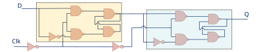
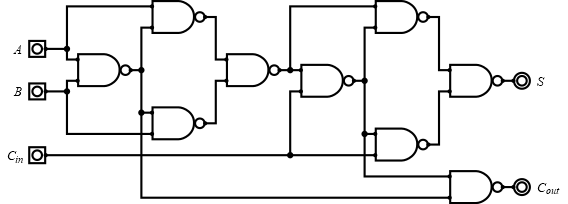
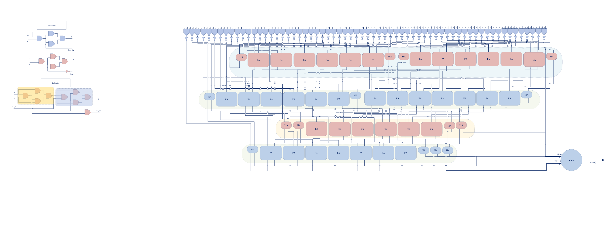

# Wallace-Tree Multiplier and Register Integration in 180 nm CMOS

A transistor-level HSPICE design study of an unsigned **8 × 8-bit Wallace-tree multiplier**, its NAND-based arithmetic cells, and input/output register integration. The design reduces partial products through four compressor stages and produces a 16-bit result using four chained CLA4 blocks.

The archived standalone multiplier measurement gives **707.0566 ps** for one selected A0-to-M15 transition. An additional ideal-logic check of the extracted Wallace interconnect covers **all 65,536 operand pairs with zero mismatches**. This check assumes ideal AND, HA, FA, and CLA4 primitives; it does not replace transistor-level simulation.

The archived full-adder delay measurement failed. The separate CLA16 testbench has a miswired input, and the registered top-level stimulus bypasses the input registers. Consequently, a validated maximum operating frequency is **not established**, even though the top-level clock is configured to 1 GHz.

## Engineering objective

The project builds a multiplier from transistor-level logic cells and examines the distinction between arithmetic connectivity, selected propagation delay, and synchronous integration. A low-transparent D latch and a rising-edge master–slave DFF provide the storage elements. Half adders and full adders compress the 64 partial products before the final addition.

## Storage cells


*Figure 1. Reference D-latch topology from the design specification. The implemented standalone latch inverts the clock to make its enable active when CLK is low.*

The standalone latch uses 20 MOSFETs. It is transparent while the clock is low and holds data when the clock is high. Its saved stimulus creates a narrow data pulse around the closing edge at 10 ns.



*Figure 2. Master–slave DFF topology from the design specification. Opposite latch phases produce nominal rising-edge capture.*

The DFF uses 40 MOSFETs: two NAND-based latches and two clock-path inverters. The two internal clock phases have finite gate delay; ideal simultaneous complementary switching is not assumed.

| Storage experiment | Scheduled D pulse | Offset before / after nominal 10 ns edge |
|---|---|---|
| Standalone latch | 9.910–10.002 ns | 90 ps / 2 ps |
| Master–slave DFF | 9.909–10.041 ns | 91 ps / 41 ps |

These are **scheduled stimulus offsets**, not independently extracted setup/hold limits. The source decks contain no setup/hold measurements, automated boundary sweep, or numerical pass/fail criterion. Finite vector transition time and the actual clock threshold crossing also matter.

## Arithmetic cells and reduction network



*Figure 3. Full-adder reference circuit from the design specification. Two half-adder stages with complemented carry outputs feed a final NAND carry-combining gate.*

The `HA_C` cell uses four NAND2 gates and produces sum plus complemented carry. `HA` adds an inverter to provide true carry. `FA` uses two HA_C instances and one NAND2, for 36 MOSFETs.




*Figure 4. Detailed partial-product generation and four-stage reduction network. A high-resolution vector version is available in the [multiplier schematic](docs/design/multiplier-schematic.pdf).*

The multiplier contains 64 AND2 partial-product cells, 38 full adders, 15 half adders, and four CLA4 blocks. The final adder has lookahead inside each 4-bit block and serial carry connections between blocks; it is not a global 16-bit parallel-prefix tree. The archived multiplier listing counts **3062 MOSFETs**. Adding 16 input DFFs and 16 output DFFs brings the top-level count to **4342**.

## Simulation setup

| Parameter | Value |
|---|---|
| Library / corner | `mm018.l`, TT |
| Supply voltage | 1.8 V |
| Channel length | 180 nm |
| Base NMOS / inverter PMOS widths | 220 / 440 nm |
| Gate sizing | Branch-specific multipliers in the subcircuits |
| Archived temperature | 25 °C |
| Transient output interval | 1 ps |
| Latch / DFF clock | 10 ns period |
| Registered-top clock | 1 ns period, nominal 500 ps high time |
| Durations | Storage: 20 ns; FA: 80 ns; multiplier: 100 ns; top: 50 ns |

The standalone CLA deck contains two `.tran` directives, requesting 80 ns and 100 ns. The simulator replaces zero clock rise/fall times with the transient step and emits warnings. Vector input slopes are not explicitly specified. The saved multiplier input crossing occurs at 40.0500 ns for a vector scheduled at 40 ns.

## Archived timing results

| Experiment | Saved measurement | Interpretation |
|---|---|---|
| Full adder, A → S after 60 ns | **Failed: trigger not found** | A has already switched at 40 ns and stays high; there is no qualifying A crossing after 60 ns. |
| Standalone CLA16, A0 → S15 | 420.1363 ps | Numerical result from a defective standalone testbench; not a validated general CLA16 delay. |
| Wallace multiplier, A0 → M15 | **707.0566 ps** | One selected transition at the implemented load. |
| Registered multiplier maximum frequency | Not measured | A configured 1 GHz clock does not establish a verified fmax. |

The multiplier vector changes from A = B = 0 to **A = 0xF9, B = 0xFF at 40 ns**. The expected mathematical product is **0xF807**. The measurement uses the first 0.9 V crossings of A0 and M15 after 40 ns. Several operand bits change together, so this is not an isolated single-input timing test or an exhaustive worst-case result.

The full-adder vectors enumerate all eight input combinations at 10 ns intervals, but specify inputs only. No expected output buses are present in these vector files. Waveforms and a completed transient run alone are not an automated arithmetic pass/fail check.

### Standalone CLA testbench defects

The most significant CLA4 instance receives `B12 B13 B14 B12`; its fourth B input should be B15 for a conventional 16-bit adder. HSPICE warns that B15 cannot be found. In addition, the vector file drives logic high at **1.0 V**, whereas the circuit supply is **1.8 V**. The 420.1363 ps result is retained for traceability, but it is not used to certify the multiplier's final-addition delay.

The standalone CLA experiment and the multiplier's internal final adder are separate instances with different connections. The internal adder was included in the ideal interconnect check below.

## Independent arithmetic connectivity check

During repository preparation, the Wallace subcircuit's actual gate-instance connections were evaluated with ideal AND2, HA, FA, and CLA4 functions for every unsigned 8-bit operand pair. All 65,536 results matched A × B. The checker resolves node dependencies from the netlist and rejects unresolved connections or multiple logical drivers.

Run the same check with Python and NumPy:

```bash
python scripts/check_wallace_boolean.py
```

The saved result is in `results/boolean-check.json`. This verifies arithmetic reduction and inter-block wiring **under ideal primitive assumptions**. It does not verify the transistor implementation of each primitive, analog levels, hazards, timing, or the registered top-level testbench.

## Registered-top integration and timing limits

The intended interface uses 16 input registers, the combinational multiplier, and 16 output registers. A setup timing budget would require:

$$T_{clk} \geq t_{clk\rightarrow Q}+t_{comb,max}+t_{setup}+t_{uncertainty}.$$

Hold constraints require a separate minimum-delay analysis. The archive does not contain the complete validated timing terms or a frequency sweep.

More immediately, the top-level vector file names **A[7:0] and B[7:0]**, but the input DFF data pins are **A_in[7:0] and B_in[7:0]**. A and B are already the input-register output nets and the multiplier inputs. The vectors therefore drive those internal nets, bypassing the intended input-register boundary and potentially contending with DFF outputs. The listing records 16 nodes with no DC path corresponding to the undriven A_in/B_in inputs.

The operands change every 10 ns, while the configured clock period is 1 ns. This is not a demonstration of one new product every clock. Correcting the vector bus names, checking pipeline latency, measuring both timing bounds, and rerunning the circuit are necessary before claiming verified 1 GHz operation.

## Repository structure

| Path | Purpose |
|---|---|
| `experiments/latch/`, `experiments/dff/` | Storage-cell source decks and stimuli |
| `experiments/full_adder/` | Full-adder truth-table stimulus and failed timing measurement |
| `experiments/cla16/` | Standalone final-adder experiment with documented defects |
| `experiments/wallace8/` | Combinational multiplier experiment |
| `experiments/registered_top/` | Registered integration experiment with documented stimulus wiring issue |
| `models/README.md` | External model requirements |
| `results/timing.csv` | Measurements with status and limitations |
| `results/reference/` | Original `.mt0` files and relevant listing excerpts |
| `results/boolean-check.json` | Ideal arithmetic connectivity-check result |
| `docs/figures/` | Circuit illustrations |
| `docs/design/` | Vector PDF and editable VSDX multiplier drawing |
| `docs/technical-review.md` | Detailed technical findings |
| `scripts/check_wallace_boolean.py` | Reproducible ideal-logic checker |
| `scripts/run.sh` | Local HSPICE runner |

## Run the archived experiments

Supply an authorized compatible `mm018.l` in `models/` and make HSPICE available on PATH. From the repository root:

```bash
bash scripts/run.sh wallace8
bash scripts/run.sh registered_top
```

Other experiment names are `latch`, `dff`, `full_adder`, and `cla16`. The runner changes into each experiment directory to resolve `input.vec`, and writes new outputs under `runs/`.

Source decks were renamed to `circuit.sp` and only the model include path was changed. The documented electrical and stimulus defects were not silently repaired. Original failed measurements are preserved. No fresh HSPICE simulation was performed during packaging; the newly executed verification is the explicitly identified ideal interconnect check.
